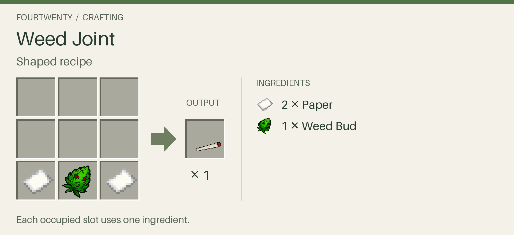
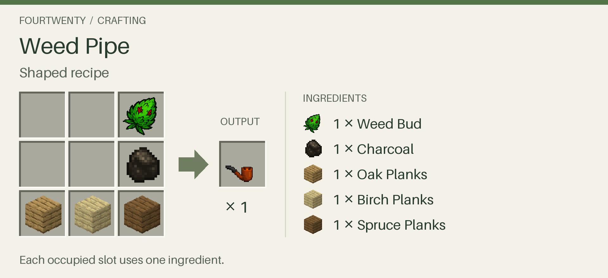
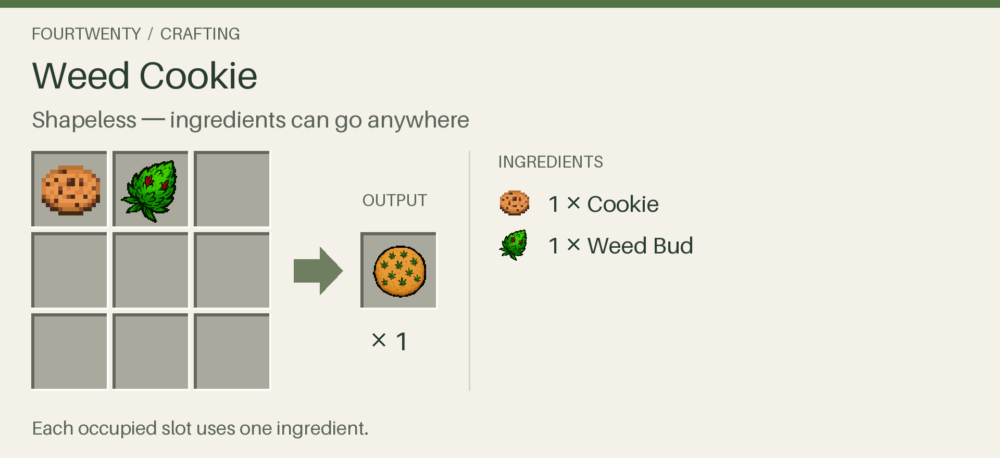
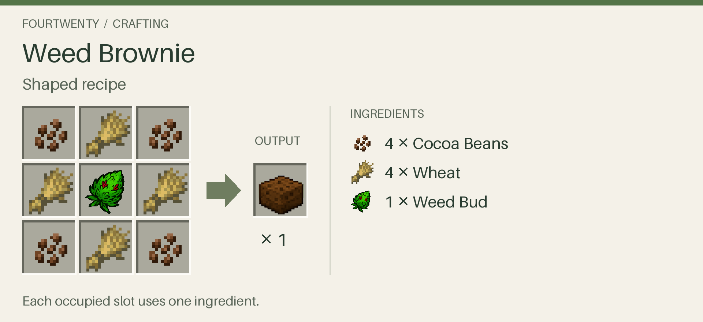
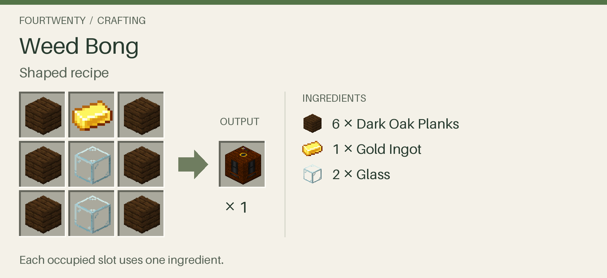
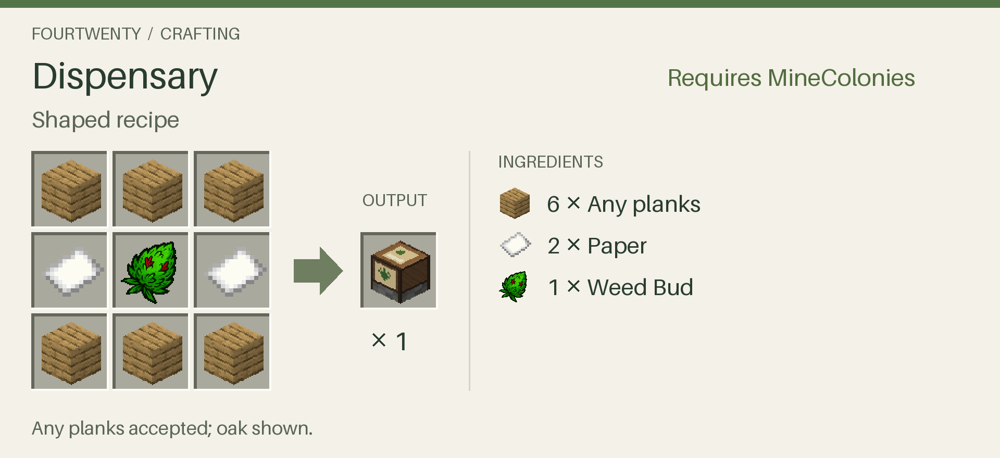

# FourTwenty 🌿

Grow wild cannabis into a farm, craft joints and edibles, build a hookah for shared effects around your base, and set out a glass bong. FourTwenty uses vanilla farming, crafting, inventory, and potion mechanics, and works without MineColonies or any other optional mod.

This compatibility candidate targets **Minecraft 1.21.1, NeoForge 21.1.218, and Java 21**. Its declared NeoForge range is `[21.1.218,21.2)`; qualification currently targets **21.1.218 specifically**. The [compatibility report](docs/COMPATIBILITY.md) distinguishes automated results from the remaining interactive and multiplayer checks. Full modpack qualification is not yet complete.

## What's new in 0.24.3

- **Budtenders request every menu ingredient:** production no longer stops when buds are missing. Couriers can supply every recipe, and the raw-bud reserve stays safe.
- **Couriers collect Trim Daddy output:** cured buds and seeds leave his pockets, and small final batches request pickup immediately.

## What's new in 0.24.2

- **Builders leave your roads alone:** under a blueprint's solid-fill placeholders, Four Twenty roads stay instead of being dug up for dirt.

## What's new in 0.24.1

- **Colonists walk on your roads:** Four Twenty's roads, slabs and stairs count as paths for MineColonies, so colonists use them instead of cutting across.

## What's new in 0.24.0

- **Gear runs free while you're high**, like the machines: the Kush Suit and Blazer use no charge while you're high, and run on their stored BI when you're sober.
- **Sensi Heights:**
  - **Woodcutter** in five levels, with a **Sawmill** your Builder builds beside it from level 2.
  - **Mine** in five levels, and the Miner's shaft pieces in cobblestone.

## What's new in 0.23.0

- **A real climb up the weed ladder:** each strain family has its own buds per harvest (Landrace 1, up to 4–5 for Golden God), its own potency (stronger, longer highs) and rarer seeds the higher it goes, paced for about 60 hours.
- **Grow Op plots give extra seeds**, 10% to 50% by tier.
- **New players get four Landrace seeds**, with MineColonies.
- **Animal pens hold their animals** in every Sensi Heights animal hut.
- **Servers:** edit the five seed-chance settings listed in the changelog. Saved configs keep their old values.

## What's new in 0.22.1

- **Sensi Heights:**
  - **Farm:** the Farmer's hut in five levels, from a timber shed with a kitchen garden to a modern greenhouse.
  - **Grow field:** a new field.
  - **Hall of Operations:** the keypad calculator, as a decoration.

## What's new in 0.22.0

- **Inspoweednetics, real electronics:**
  - **Parts:**
    - resistors, capacitors, coils, diodes and switches;
    - logic gates, latches and flip-flops;
    - transistors and an op-amp;
    - shift registers, multiplexers, adders, comparators and registers;
    - a 7-segment display.
  - **Wiring and solving:** wired with Hemp Thread and the 9-wire Eighth Ribbon, and solved like SPICE, with real gate delays.
  - **Big chips:** the Manyfier and the Fewinator multiply and divide 16-bit numbers.
- **Panels:**
  - **Rolling Tray boards:** buttons, toggles and displays mount flush.
  - **The Dankoder:** reads a whole keypad.
  - **Key labels:** each key can carry a short label and a glow.
  - **Lamps:** any Four Twenty lamp lights from a circuit.
- **Nah, Skip Me, Bro:** two wires cross in one block without touching.
- **Seven creative tabs:**
  - Four Twenty
  - Strains
  - Hemp & Terpenes
  - Boundless Inspiration
  - Inspoweednetics
  - Kush Suit
  - Décor

## What's new in 0.21.0

- **Real circuits, red and black:** power flows only around closed loops. A red Wick on any side of a block is +, a black Wick is −; other colours only join Wicks of their own colour. The Hit Box is a real transformer with two isolated windings.
- **Twin Wick and Daisy Wick:** two-core cables in every tier. A Twin Wick wires everything it touches in parallel; a Daisy Wick wires the blocks along it in series and closes the loop itself.
- **Lit Bits and the Weedweeno:** RGB lamps that look like our lamps in any colour and behave like real LEDs, placed and numbered by the Sticky Finger, and run by Lua light shows on the Weedweeno. Bit Chits carry shows between Weedweenos.
- **Re-Up Stations** have their own battery and screen, and charge gear faster than their input.

## What's new in 0.20.0

- **Real electricity:** Boundless Inspiration is measured in Willards (W), Ignus (Ig), Kerberos (Kb) and Phus (Φ), and every Wick network is solved as a DC circuit. Wicks are rated like real cables; the Inspoweedometer reads it all.
- **Kush Suit and Blazer:** armour and an arm laser whose powers run free while you're high, or on their stored BI when you're not, unlocked further by terpenes of each piece's colour family; charged at Re-Up Stations or with a Dab Cell.
- **Bud Barn** (with MineColonies): its Trim Daddy trims and cures the colony's rough buds by hand at real Trim Trays and Curing Racks, and sends Cured Buds and seeds to the warehouse, so Dispensaries stay stocked.
- **Pave Pen:** lays our roads straight into the ground with weed, upgrades them with the smooth stone or gold you carry, and (as the Pave Pen Pro) lays and reshapes slabs and stairs. Press V for its settings.
- **Construction benches:** the Joint, Blunt, Spliff and Cannon run on BI and make 2, 3, 4 and 6 times as many building and coloured blocks. Each item costs 48 Ws from a bar on the bench, which charges at 420 to 3,360 W by tier. JEI fills them like a crafting table.

## What's new in 0.16.0

- **The Dispensary** now lives only in Sensi Heights, and huts from the old FourTwenty pack carry on from there.

## What's new in 0.15.0

- **Weed processing:** harvest Rough Buds, trim them for Trimmed Buds and seeds, cure them into smokeable Cured Buds. A Trim Tray and Curing Rack need no power; six powered machines do it faster and take hoppers.
- **Boundless Inspiration:** the mod's electricity, the science of Inspoweednetics. Power is in Willards (W), energy in Willard-seconds (Ws), current in Ignus (Ig), voltage in Kerberos (Kb) and resistance in Phus (Φ), and every Wick network is solved as a real DC circuit. The Inspoweedometer reads it all. A burning Hookah puts out 420 W, with the Double Hose and Big Bertha as its upgrades, Stash blocks hold it, Wicks carry it, and the Hit Box steps it between tiers. One charcoal and one cured bud burn for a minute and run four machines of that tier, or machines run free while a high player is within 21 blocks.

## Grow Ops and the Think Tank

Five tiers of indoor plot grow any crop faster: the Closet Grow, Grow Tent, Hydro Bed, Aero Pod and Cosmic Kush Pod. Upgrade one in place by using the next tier on it, and the crop stays. The Think Tank runs research with no colony: pick a study, load it, and keep a crop growing on a plot within 8 blocks. The Blaze tier adds the Grand Hookah, The Vault and Gold Wick.

## Hybrids, extracts and tubes

Every seed now has Potency, Yield and Length, rated 1 to 5. Above the 16 bred strains is a ladder of 22 more: biome landraces, Crosses from the Pheno Chamber, then Double Crosses, Ultras and Golden God, which come from pollinating. Grown side by side, Double Cross parents sometimes cross on their own, and a Buzz Bot, a robot bee that runs on Cured Buds, makes it certain. Better strains need better Grow Ops, and grow slower.

The Rosin Rig refines Cured Buds into extracts that burn longer in a Hookah and hit harder in a pipe. Transport Tubes link machines, Hookahs and Terpinators into one network that carries items both ways. The Construction Joint, Blunt, Spliff and Cannon are powered benches that make 2, 3, 4 and 6 times as many building and coloured blocks. Hookahs hold 64 buds, and light themselves only when something needs the power, or with the Light button. Everything you've smoked shows as one badge.

## What's new in 0.14.1

- **The Sensi Heights Warehouse:** five levels from an open oak pavilion over a sunken rack room to a full concrete and glass depot, with up to 102 racks and room for 8 Courier's Huts inside it. Racks stay put through every upgrade.

## What's new in 0.14.0

- **The Hotbox:** a creative-only block that keeps the 3x3 chunks around it running for an hour after you leave, and never while the server is empty. Walk into the area and it starts by itself. Hold the Build Tool or a Hotbox to see the green outline; JourneyMap shows it too.

## What's new in 0.13.2

- **The Town Hall gets a courtyard:** level 5 has two couch circles in Yellow Brick Road and grass, and every level has room for it. Town Hall 4 is reworked with paved floors, green concrete and blue glass.

## What's new in 0.13.1

- **The Sensi Heights Town Hall is complete:** all five levels, from the oak apse and weed garden of level 1 to a three-storey rotunda and garden atrium at level 5, double-glazed in green terpene glass.

## What's new in 0.13.0

*Smoke it, see it, mix it.*

- **Strains.** Seeds, buds, crops and joints now carry a strain: plain Landrace, or one of 16 bred strains in four families (Neutrals, Warm, Green, Cool), each with its own quiet effect, coloured smoke and icon.
- **The Inspiration Infuser** (Steel or Lab). Smoking inspires colours. At the Infuser, drop beads of resin into a pool of liquid weed magic until it matches a colour you're inspired by, and you catch that colour's terpene. Nothing is timed and nothing can fail. Its Infuse tab breeds strain seeds.
- **16 Minecraft-colour terpenes** with names to discover (Bone Meal Haze, Creeper Kush, Obsidian Couchlock...), and their hemp, concrete and Minecraft-themed rugs.
- **The Terpinator, rebuilt** in Steel or Lab: pick a colour you've caught, feed it weed, get vials.
- **A colour drift instead of nausea**, a reworked hookah with a stem, bowl and hose, and a joint you actually raise to your lips.

## Changes from 0.12.0

- **No vanilla dye:** dye lamps, inverted lamps and trims are made with the Minecraft-colour terpenes.
- **Terpinator:** production only. The old press/refine/blend stages are gone; an existing Terpinator keeps its buds and drops its resin, bases and accords. Base terpenes, accords and resin stay in the game for old worlds but are no longer made.
- **Hookah:** the weed bong is called the Hookah (its id is unchanged).
- **Sensi Heights v75:** Dispensary 5 in FourTwenty whites, re-textured Dispensary and Tavern panels, and a `wip` folder holding draft Town Halls 2-5.
- See the [CHANGELOG](CHANGELOG.md) for 0.12.0 and earlier.

## Grow and harvest

Find wild weed in Plains, Savanna, Grove, and Meadow biomes, collect its seeds, and plant them on farmland. Cannabis grows through eight stages and responds to normal crop conditions and bone meal.

Breaking an immature crop returns one seed. A mature crop drops its seed back and its strain family's Rough Buds:

| Family | Buds a harvest | Potency | Trimming seed chance |
|---|---|---|---|
| Landrace | 1 | 1 | 14% |
| Neutrals, Warm | 1–2 | 2 | 15% |
| Green | 2 | 2 | 10% |
| Cool, Biome | 2 | 3 | 10% |
| Cross | 2–3 | 3 | 8% |
| Double Cross | 3 | 4 | 2% |
| Ultra | 3–4 | 4 | 1% |
| Golden God | 4–5 | 5 | 0.5% |

**Seed traits** (yield, potency, length) add on top of the family's numbers.

**Potency** makes a high a little stronger and longer:

| Potency | Extra effect levels | Lasts |
|---|---|---|
| 1 | none | as normal |
| 2 | none | ×1.1 |
| 3 | +1 | ×1.2 |
| 4 | +1 | ×1.3 |
| 5 | +2 | ×1.4 |

**Grow Op plots** add an extra-seed chance at every harvest:

| Plot | Extra-seed chance |
|---|---|
| Closet Grow | 10% |
| Grow Tent | 20% |
| Hydro Bed | 30% |
| Aero Pod | 40% |
| Cosmic Kush Pod | 50% |

**Starting seeds:** with MineColonies, each new player gets four Landrace seeds once. **Tooltips:** a seed's or bud's tooltip shows its family's buds, potency and growth.

The whole ladder, from four Landrace seeds to Golden God, is paced for about 60 hours of play. Right-clicking a mature crop resets it to age zero and retains one seed for replanting; the remaining harvest drops normally. Right-clicking an immature crop does nothing.

MineColonies farmers recognize the crop and its seeds through their native farming support. Actually Harvest uses its configured harvesting, replanting, tool-area, and XP behavior. With both installed, FourTwenty checks colony permissions for every cannabis crop in an area harvest. Datapacks can override the loot and additive tags.

## Craft and consume

Craft joints, pipes, cookies, brownies, hookahs, and bongs with the existing recipes. Cookies take 200 server ticks to start their effects; brownies take 300. At 20 ticks per second, that is 10 and 15 seconds. Another edible cannot be consumed while a dose is pending.

Pending effects survive dimension travel, but cancel on logout, actual death, or server shutdown. Sleep and changes to the daylight clock do not advance the delay. Effects already applied follow vanilla effect merging and milk removal. MineColonies citizens exclude the cookies and brownies from food selection; normal inventory storage and transport remain available.

### Crafting recipes

Each recipe below makes **one item**. Follow the shown arrangement for shaped recipes; the cookie ingredients can go anywhere in the crafting grid.

<!-- Regenerate cards with Pillow 12.3.0: python3 tools/generate_recipe_cards.py --minecraft-jar /path/to/1.21.1.jar -->

#### Weed Joint

**Ingredients:** 2 paper + 1 weed bud → **1 Weed Joint**.



#### Weed Pipe

**Ingredients:** 1 weed bud + 1 charcoal + 1 oak plank + 1 birch plank + 1 spruce plank → **1 Weed Pipe**. Use the specific wood types shown.



#### Weed Cookie

**Ingredients:** 1 cookie + 1 weed bud → **1 Weed Cookie**. **Shapeless — ingredients can go anywhere.**



#### Weed Brownie

**Ingredients:** 4 cocoa beans + 4 wheat + 1 weed bud → **1 Weed Brownie**.



#### Hookah

**Ingredients:** 6 dark oak planks + 2 glass blocks + 1 gold ingot → **1 Hookah**.



#### Bong

**Ingredients:** 4 glass blocks + 1 water bucket → **1 Bong** (the bucket is returned).

```
 G
 G
GWG
```

`G` glass, `W` water bucket.

## Dispensary (optional MineColonies integration)

**Requires MineColonies.** With the pinned MineColonies build installed, craft the hut using **6 of any planks + 2 paper + 1 weed bud → 1 Dispensary**. Oak is shown as an example; any combination of planks works.



Use **Build Tool → Switch Pack → Sensi Heights → Craftsmanship → Dispensary** to place the shop. The level selector previews levels 1–5; request construction, upgrades, and repairs through the standard hut controls. The bundled design is the Sensi Heights Dispensary, all on one 11 × 24 footprint:

- a wooden shop, then a stone shop, then a modern storefront with the green cross;
- level 4 adds a deeper store with lit display cases and a back lounge;
- level 5 adds a rooftop lounge.

Keep the block above the hut clear: the hut block is a two-block counter.

Reserve **11×24 blocks, 11 tall**, for every level: the hut stays in the same place as the shop grows. Facing the north-facing entrance, that is five blocks to either side of the hut, seven toward the entrance and sixteen behind it, from two layers below the hut's floor to eight above it. Rotate or mirror this area with your preview.

| Completed level | Built | Indoor seats | Rooftop seats | Joint stock target |
| --- | --- | ---: | ---: | ---: |
| 1 | front 13 rows | 6 | | 16 |
| 2 | front 13 rows | 6 | | 32 |
| 3 | front 13 rows | 6 | | 64 |
| 4 | 19 rows (store and lounge) | 9 | | 96 |
| 5 | all 24 rows and the roof | 9 | 17 | 128 |

Customers use any seat, but skip the rooftop in the rain.

Hire one Budtender and stock your warehouse with weed buds and paper. Native couriers supply production: **one bud and two paper make one joint**. As the Dispensary levels up he also crafts the rest of the menu with the crafting-table recipes: **weed cookies** at level 2 (a cookie and a bud), **pipes** at level 3 (oak, birch and spruce planks, charcoal and a bud) and **weed brownies** at level 4 (four cocoa beans, four wheat and a bud), keeping each item stocked. He makes one small batch at a time for whichever item is least stocked against its target (8 joints, 4 cookies or brownies, or 2 pipes), so the shop always has some of everything. He also keeps a reserve of raw buds that he never crafts from (4 at level 1, up to 16 at level 5), for bong sessions and the hookah, and requests buds from the colony to keep that reserve plus his next batch on hand. Use the hut and linked racks for service stock; the decorative barrel is separate storage. The **Dispensary service** tab shows staff, ingredients, total joints, stock target, joints available in the shop, waiting customers, and supply problems. Total stock includes the Budtender's inventory; stock the Budtender carries out of the shop is not immediately available. Standard management and crafting tabs remain available. Clear storage space if production backs up.

Adult citizens with an assigned, completed home of any level (including guards and unemployed adults) can develop cravings, but **only after their first exposure to weed**: standing in a burning hookah's area, being within 4 blocks of a colonist or player smoking a joint or pipe, or a dose. Children do not participate. Every citizen's record logs that first exposure (N/A until it happens); existing citizens start unexposed.

First exposure rolls the citizen's **affinity** once:

- **Type:** not interested 20%, smoker 35%, edibles only 20%, both 25%.
- **Frequency:** every 4 days, every 2 days, daily, twice a day, three times a day, or four times a day. It starts somewhere from every 4 days to three times a day, usually daily.
- **Drift:** each dose, and the first hookah session each day, has a 10% chance to shift frequency one step (75% up, 25% down).
- **Tolerance break:** a citizen pushed past four times a day takes a two-day break: a small happiness penalty and no cravings. They then return to their original frequency.
- **Where to see it:** the citizen's happiness tab shows their cannabis status with type and frequency in the tooltip, or "never tried it".
- **Settings:** `affinityChangeChance`, `affinityUpChance`, `toleranceBreakTicks`, `toleranceBreakWeight` and `secondhandSmokeRadius`. The daily interval and grace (`demandIntervalTicks`, `demandGraceTicks`) are scaled by frequency.

A level-1 dispensary can serve them. Citizens use a carried joint, edible or pipe first, or visit to collect. What a visit hands out depends on the citizen's home: level 1–2 homes have one at the shop; level 3–4 homes take a supply away (a pipe holds 4 doses, or 4 cookies or brownies) and use it whenever due; level 5 homes have one at the shop and take a pipe home. They take the best item in stock: brownie, then pipe, then cookie, then joint. If there is nothing to take home, they have one at the shop and complain. Edibles count as a dose but never as food, and restaurants never serve them. Like at the restaurant, they wait anywhere inside the shop and the Budtender walks over to serve them; if he can't, they serve themselves after 20 seconds. They prefer indoor seating, smoke, and resume normal activity. Hunger, illness, sleep, combat, raids, and Kingdom's Gate rituals take priority. Missing stock causes a delayed retry.

By default, completed consumption satisfies demand and grants **one extra maximum-health heart for 24,000 simulation ticks** (20 minutes at 20 TPS). It does not immediately heal; another dose refreshes the benefit without stacking. Satisfaction gives a small happiness benefit. After satisfaction expires, a further 24,000 ticks of unmet demand produces a small penalty; newly eligible adults also receive a 24,000-tick grace period. Server configuration can change timings. Sleep and clock changes do not grant extra doses, and server downtime does not advance these timers. Collection alone grants no benefit.

**Players** can buy too: inside the shop, right-click the Budtender while holding an emerald to open the Dispensary menu, then click an item. Colony members (hut permission) are served free; other players pay emeralds, which go into the hut's storage. Default prices: joint 1, weed cookie 1, weed brownie 2, pipe 3 (`jointPrice`, `cookiePrice`, `browniePrice`, `pipePrice`). The menu grows with the Dispensary level: joints at level 1, cookies at 2, pipes at 3 and brownies at 4. Items show as sold out until they are in stock.

The [Phase 5 handoff](docs/DISPENSARY_PHASE5.md) records automated and client evidence separately from outstanding native builder, upgrade, repair, and gameplay observations.

## Sensi Heights style pack

FourTwenty ships the **Sensi Heights** MineColonies style: "A hillside town that grows around the grow." Pick it in the Build Tool (**Switch Pack → Sensi Heights**). It currently includes:

- **Supply camp:** stocked racks and weed seeds. It is also level 1 of the Workshop.
- **Workshop (levels 1–5):** an upgradable decoration. Its racks are never broken on upgrade.
- **Residence (levels 1–5).**
- **Builder's Hut (levels 1–5):** an open shelter whose placeholders keep all the surrounding terrain, for a quick first build, growing through a timber cabin and a stone-and-timber house into a two-story house with a front yard.
- **Tavern (levels 1–3):** furnished with FourTwenty hemp beds (a king at level 3) and side tables.
- **Restaurant (levels 1–5):** a timber dining hall with a sunken seating pit, growing into a polished restaurant with a patio, a roof terrace, an upper dining room and a skylight. Its cook works from furnaces in the kitchen, and diners sit at every table.
- **Dispensary (levels 1–5):** the same design as the FourTwenty pack's.

More huts are added as they're built. The pack lives in its own repository and is bundled with `python3 tools/import_sensi_heights.py <pack>/sensiheights`, which validates it (huts link to their own files, no ProjectRed/CB blocks). A few blueprints use a Farmer's Delight cutting board, which is simply left out without that mod. The Tavern's beds and side tables are FourTwenty's own hemp beds (level 3 has a king) and side tables.

## Strains, the Inspiration Infuser and the Terpinator

**Strains.** Every seed, bud, crop and joint carries a strain. Wild plants and starting seeds are **Landrace**; the 16 bred strains (Couchlock Hum, Wake & Bake, Cherry Pie, Blue Dream...) belong to four families, Neutrals, Warm, Green and Cool, shown in their tooltip. A crop keeps its strain through growth and harvest, joints are rolled from one strain, and the **pipe** loads buds like ammo (put buds on it in your inventory; one bud per hit). Each strain has its own quiet effect (no potion swirls), coloured smoke and a faint screen tint.

**Inspiration.** Smoking inspires you with colours: plain weed with the 16 Minecraft colours, a strain with its four hemp colours as well. Each colour's inspiration rises from 1 to 5 and never fades. A hit brings a gentle colour drift: the view sways a little and the colours ripple across the screen.

**The Inspiration Infuser** (Steel: 3 glass over iron, a weed bud and iron, over polished blackstone, glowstone dust and polished blackstone; Lab: quartz and white concrete instead). Pick a colour you're inspired by on your mind's map, then drop beads of resin (globs, drops, drips, specks; drops fall 1, 4 or 8 at a time) into the pool until it matches. Fully inspired, the pool's edge glows green while you're still on track to a working recipe and red when you're not. Catching a colour unlocks its terpene; near-identical colours unlock together. The **Infuse** tab turns a Landrace seed and a Minecraft-colour terpene into a seed of that hue's strain (olive takes green and brown). Your pool and catches are your own and persist.

**The Terpinator** (Steel or Lab, crafted like the Infuser round a brewing stand): pick a colour you've caught, feed it weed and press Start. Each bud makes two vials. The 16 Minecraft colours take any weed; a hemp colour needs weed of its family.

**Hemp blocks** come in the 64 hemp colours, the 16 Minecraft colours and Natural Hemp, each with stairs and slabs. 4 weed buds make 2 Natural Hemp; a terpene in the middle of 8 hemp blocks (any colours) dyes them its colour. Stairs and slabs craft the usual way or in a stonecutter.

The coloured glass and pane textures are recoloured from [Classic Faithful 64x](https://faithfulpack.net/) (via the Malevolent Gods resource pack), used under the Faithful License; see `licenses/Faithful-LICENSE.txt` and `tools/source_textures/faithful/README.md`.

The models in `assets/domum_ornamentum` are [Domum Ornamentum](https://github.com/ldtteam/domum-ornamentum)'s shingle models with overlapping faces pulled apart, and stay under its GPL-3.0 licence (`licenses/DomumOrnamentum-GPL-3.0.txt`).

The Terpinator's screens use [Atkinson Hyperlegible](https://brailleinstitute.org/freefont) (Braille Institute, SIL Open Font License 1.1; see `licenses/AtkinsonHyperlegible-OFL.txt`), rendered from TrueType so the text stays crisp at any GUI scale. Its models come from `tools/generate_terpinator_model.py` and the Infuser's from `tools/generate_infuser_model.py`; `tools/render_block_model.py` renders any block model with headless Blender for checking.

The 64 hemp colours (and, for concrete, powder and rugs, the 16 Minecraft colours too) come as **concrete** (one flat colour, like vanilla's) and **concrete powder** (3 sand, 3 gravel, 2 weed buds and the terpene make 4; it sets into concrete in water, and MineColonies' Concrete Mixer makes both), **stained glass** and **glass panes** (a terpene in the middle of 8 glass or panes dyes them; 6 glass make 16 panes), **rugs** (2 hemp blocks make 3; rugs of the same colour side by side join into one larger rug, with a border only round its outside, inset a pixel with rounded corners so the floor shows, and the pattern flowing across the inside; every colour has its own pattern; a terpene in the middle of 8 rugs recolours them; Natural Hemp rugs too) and **lamps** (3 glass, a weed bud and the terpene make 4; inverted lamps and trims as for the dye colours, with a halo in their own colour).

**Couches** come in every colour and Natural Hemp: a hemp cushion and back with softened edges, arm rests and dark oak legs. Craft 3 hemp stairs of a colour over 2 sticks for **3 couches**. They join like stairs: place them side by side for a sofa (the arms move to the ends), round a corner for a sectional, or in any arrangement stairs would make, and colours mix. Fences, walls and panes don't join them. Right-click one with an empty hand to sit (one to a couch), and sneak to stand up. **`/sit`** sits you down wherever you stand: on a couch, or on the floor, a step or a slab. With MineColonies, colonists sit on couches tagged as seats (taverns, restaurants, the Dispensary) at the cushion and facing out, and a couch a player is sitting on counts as taken.

**Roads** come in three tiers, each faster to walk on: a **Cobble Path** (5% faster), a **Paved Road** (10%) and a **Yellow Brick Road** (15%), for players, animals and colonists alike. Like the rugs, roads join into whole roads, with a border only round the outside and the paving running on unbroken across the inside: rounded fieldstones edged with bigger stones, pale flagstones inside a granite kerb, and soft golden bricks with an amber border, gold scrollwork and rosettes at the corners. Their sides are a cut through the road (the surface's edge, what it's laid on, the footing) with corner quoins where the road turns, and their undersides are structural, for bridges and raised roads. They stand a pixel lower than a full block, like dirt paths, so a lamp or glowstone set flush beside a road shows as a strip of light along it. Each tier has **slabs** and **stairs** sized to the road: a top or double slab is flush with a road and joins it, and a ramp of stairs runs from one road to the next with the border down its sides and no line across the top. Craft 2 cobblestone, 2 gravel and a weed bud for 4 Cobble Path; 8 Cobble Path round smooth stone for 8 Paved Road; 8 Paved Road round a gold ingot for 8 Yellow Brick Road. Slabs (3 make 6) and stairs (6 make 4) craft like any other, or come from a stonecutter.

Terpene names are discovered: a terpene shows as an unnamed vision until you catch its colour in the Infuser.

## Side tables

Nightstands in oak, spruce, birch, jungle, acacia, dark oak, mangrove, cherry, crimson and warped wood: a slim top, a drawer with a brass knob, slim legs and a low shelf. Craft 3 slabs over planks either side of a weed bud, with two plank legs below, for **2 side tables**. They're decoration and face whoever places them.

## Beds

Hemp beds in the same ten woods: tall head posts and a headboard, a footboard, a mattress, a pillow and a draped blanket that's lime when placed. Right-click any part with a dye to recolour the blanket (all 16 colours); it's turned back while someone sleeps in it. They're real beds (sleeping, respawn) and count as beds for MineColonies homes and taverns. Craft 3 weed buds over 3 planks for **1 hemp bed**.

Place two hemp beds of the same wood side by side, facing the same way, and they join into a double; a third makes a king, one block longer (while you aim the third bed, a ghost shows the king, red if something is in the way past the foot, in which case it stays a single). Every column is still its own bed, so two or three people, or colonists, can share one. Breaking any part breaks the whole bed and gives back each bed that went into it.

## Lamps

Coloured lamps in all 16 dye colours, for builds that need lighting without another mod:

- **Lamp:** lights while powered by redstone. Craft 3 glass, a weed bud and the dye (anywhere in the grid) for **4 lamps**.
- **Inverted Lamp:** lit unless powered, so it is always on as decoration. Craft a lamp and a joint.
- **Lamp Trim:** a thin, always-lit plate that sticks to whichever face you click, like a microblock cover. One lamp (plain or inverted) crafts into 4.

Lit lamps and trims glow with a soft coloured halo that spills onto neighbouring blocks, including in your inventory and hands. The lamp textures and halo come from [ProjectRed](https://github.com/MrTJP/ProjectRed)'s illumar lamps (MIT License; see `licenses/ProjectRed-LICENSE.txt`). The bundled Dispensary uses them, so it needs no lighting mod. `tools/import_dispensary_blueprints.py --lamps-only` converts blueprints that use ProjectRed illumar lamps or CB Multipart lamp covers to these blocks.

## Twin Wick and Daisy Wick

Two-core cables that do the routine wiring for you. Each carries a + core and a − core in one block, and each core is rated like one single Wick of its tier. They come in every tier (Hemp, Rolled, Glass, Gold) and take dyes like Wicks; a cable joins only cables of its own kind and colour.

- **Twin Wick (parallel):** every powered block it touches is wired across it, + to + and − to −, whatever face it touches and whichever way the block faces, so it can't be wired backwards. Lay it beside a row of blocks, or through them (Hookah, cable, machine, cable, machine): either way they're all in parallel. Craft a red and a black Wick of a tier side by side.
- **Daisy Wick (series):** the blocks along it are wired one after another into a single string, and its return core closes the loop for you. Loads take the current in at +, sources put it out at +, so it doesn't matter which end you start from or where the source sits; two sources add up like batteries. Ten Lit Bits on a Rolled Daisy Wick from a Double Hose each get 4.2 Kb, like a real LED string. A Daisy Wick can't branch or close on itself: if it does, it carries nothing and the Inspoweedometer says why. Craft a red Wick of a tier above a black one.
- **Red and black Wicks:** a red single Wick is + and a black one is −, on any side of any powered block, and they join a Twin Wick's + and − cores. Other colours join only Wicks of their own colour. A Daisy line with a red Wick at one end and a black Wick at the other runs between them. Eight Wicks of a tier round a red or black dye make eight red or black Wicks. The Hit Box takes wiring on its front or back as its high-voltage winding and on its left or right as its low.

The Inspoweedometer reads a Twin Wick's voltage between its cores and the current on each, and a Daisy Wick's string current and voltage there.

## Electronics

Real components on the same circuits as everything else, solved the way SPICE solves them: Kirchhoff's laws, Newton's method for the parts that aren't linear, and time steps for the parts that store energy. Units: Willards (W), Ignus (Ig), Kerberos (Kb), Phus (Φ), Garcias (Ga, capacitance) and Marleys (Ma, inductance). The full design is in [docs/electronics/audit-and-plan.md](docs/electronics/audit-and-plan.md).

**Wiring.** Components have pins on fixed faces, shown by their coloured leads: two-pin parts run back to front; logic parts take inputs at the back or on their left and right, give their output in front, and are powered by VDD on top (red lead) and GND underneath (black lead). Any Wick, or the thin **Hemp Thread**, on a pin face joins that pin, and two pin faces touching join directly. (Machines are different: a red Wick is + and a black Wick is − on any side.)

| Part | What it is |
|---|---|
| Resinator | A resistor, 1 Φ to 1 MΦ, rated 10 W: past that it burns out in smoke |
| Kief Cap | A capacitor, 1 µGa to 1 Ga |
| Spliff Coil | An inductor, 1 mMa to 10 Ma |
| One-Hitter | A diode: current flows from its back to its banded front |
| Zen Hitter | A Zener diode, 2.4 to 42 Kb: banded end to +, it holds its voltage |
| Toggle Joint, Kill Switch, Puff Button | A switch you flip, a switch closed by redstone, a button closed for a second |
| NOT, Buffer, AND, OR, NAND, NOR, XOR, XNOR Nug | Logic gates |
| Tri-State, Latch, Flip-Flop Nug | A tri-state buffer, an SR latch, a D flip-flop |
| Ticker | A clock, 2 ms to 10 s |
| Sativa FET, Indica FET | N- and P-channel MOSFETs: source at the back, drain in front, gate on the left (green lead). Build your own CMOS logic from them |
| Puff-Pass Nug | A shift register: data in at the back, clock on the left, latch on the right, 8 outputs and a carry on its bus face in front. Chain them, carry to data, for 16 bits or more |
| Pack Nug | A shift register the other way: 8 inputs on its bus face, load and clock, out one wire, bit 7 first |
| Sampler Nug, Dealer Nug | An 8-to-1 multiplexer and a 1-to-8 demultiplexer, selected by channels 0 to 2 of a bus on their left |
| Blend Nug | Bitwise logic on two buses, all nine wires at once: AND, OR, XOR, NAND, NOR, XNOR, NOT A or A (use it to step) |
| Stacker Nug | Adds two bytes and a carry in, or subtracts; carry (or borrow) out on the C wire, so two make 16 bits |
| Scale Nug | Compares two bytes: channel 0 is A < B, 1 is A = B, 2 is A > B |
| Jar Nug | Keeps a byte: takes its inputs on each rising clock, drives them out until release is 1, so several can share one bus |
| Eighth Ribbon | Nine signal wires in one flat cable: channels 0 to 7 (striped in the resistor colour code) and the carry (grey). It joins other Ribbons, Roach Clips and bus faces |
| Roach Clip | A piece of Ribbon that clips one channel out to a Wick, Hemp Thread or single pin; use it to pick the channel |
| Hype Amp | An op-amp: + on the left, − on the right, output in front, powered like a Nug; with Resinators for feedback it amplifies by their ratio |

Every electrical item shows its real-world name, quietly, under its name in its tooltip (a Puff-Pass Nug is a shift register, a Hookah a generator, the Inspoweedometer a multimeter, with the units' real names too). Use a part to step its value (sneak to step back). Logic reads its inputs against its own supply (below 30% is a 0, above 70% a 1), drives its output through a real output resistance, lets it float with no power, and answers 1 ms after its inputs change, so logic of any depth settles inside a tick and an oscillator runs at the rate its gates allow. The Inspoweedometer reads whatever you look at, live, while you hold it; use it to hold a reading above the live one to compare. It reads a part's value, voltage, current and power, or a logic part's pins and the bits they read as, a FET's gate and drain voltages and its current, or a Hype Amp's inputs and output, or a chip's buses as bits (bit 7 first). Circuits keep their state through chunk reloads and restarts, and share a time budget each tick: past it, they wait rather than slow the server.

**Test supplies** (creative): a **Bottomless Stash** of each tier, which never runs dry, and the **Bench Rig**, a variable DC supply (use it to step its voltage from 0.5 to 4,200 Kb, sneak-use to step its current limit).

## Lit Bits and the Weedweeno

Programmable RGB lamps, part of Inspoweednetics. Nothing here needs MineColonies.

- **Lit Bit:** an RGB lamp that works like a real LED. It looks like a Four Twenty lamp in any colour, with the same glow. Wire it with a red Wick (+) and a black Wick (−) on any sides, or a Twin or Daisy Wick; it lights only on a closed loop at Puff voltage (4.2 Kb). Below about 2.5 Kb it stays dark, and as the supply sags it dims. Each channel draws current in proportion to how bright it is: 0.238 Ig at full, so full white is about 0.72 Ig, 3 W. With no return it stays dark; on a higher tier's voltage it overloads in smoke, without breaking. Use one to see or change its **ID**. Craft red, green and blue dye over glass, a Hemp Wick and glass, and a copper ingot below, for **4 Lit Bits**.
- **Sticky Finger:** a glove that places Lit Bits from your off hand (or inventory) and numbers them as it goes: 1, 2, 3 and on. Sneak-use it in the air to set the next ID. A Lit Bit placed where one was broken gets that one's ID back, whatever the glove says. Craft a slime ball, Natural Hemp, leather, Natural Hemp and a copper ingot.
- **Weedweeno:** a small computer for light shows. It runs Lua programs that set Lit Bits by ID, wirelessly, within 64 blocks. It's a 5 W Puff load on a loop of its own (or free near a high player), and comes with four presets: Rainbow, Chase, Pulse and Strobe. Use it for its editor: your programs on the left, the code with line numbers in the middle (an error's line is marked), and Run, Stop, Save, New, Copy, Delete, Export and Import below, with a console. Keep as many programs as you like; a broken Weedweeno keeps them. Craft copper, a glass pane and copper; redstone, an Inspoweedometer and redstone; copper, a Hemp Wick and copper.
- **Bit Chit:** a slip that carries a program. Export onto a blank one from a Weedweeno, then Import it into another. Craft a written Bit Chit with a blank one to copy it. Four paper and an ink sac make **4 blank Bit Chits**.

A show is a loop that sets colours and then calls `frame()` to wait for the next tick:

```lua
while true do
  for i, id in ipairs(ids()) do hsv(id, i * 30 + time() * 90, 1, 1) end
  frame()
end
```

| Function | What it does |
|---|---|
| `set(id, r, g, b)` | sets every lamp with that ID in range (0–255 each) |
| `hsv(id, h, s, v)` | the same from hue (0–360), saturation and value (0–1) |
| `off(id)`, `all(r, g, b)` | one ID dark; every lamp in range one colour |
| `ids()`, `count()` | the IDs in range, sorted, and how many |
| `frame()`, `sleep(seconds)` | wait for the next tick, or for so long |
| `time()`, `tick()` | seconds and ticks since the show started |
| `rgb(h, s, v)` | returns `r, g, b` for a hue |
| `print(...)` | writes to the Weedweeno's console |

Shows run on the server in a sandbox: no files, no OS, no network, and no loading code from text. Each frame has 2 ms. A show that never calls `frame()` is cut off and stopped as too slow, and so is one whose frames keep running over. Programs hold up to 30,000 characters. Server owners can tune the range, the budgets and the LED numbers, or let only operators program, in `fourtwenty-lights-server.toml`. The Lua is [Cobalt](https://github.com/SquidDev/Cobalt) (MIT License), bundled in the mod jar.

## Use a bong

Place the bong anywhere; it faces you, bowl toward you. Right-click it with a **Weed Bud** anywhere in your inventory to take a hit: it uses one bud (none in creative) and gives the same effects as a pipe, with bubbling and smoke. Hits have a 5-second cooldown. Without a bud you are told to pack it first. With MineColonies, a hit is also secondhand smoke for colonists within 4 blocks.

### Specialty bongs

Upgrade a glass bong at the crafting table (shapeless) with two ingredients. Each specialty bong works like the glass bong, but a hit also gives a **one-day buff** (24,000 ticks):

| Bong | Upgrade with | Your buff | Colonist skills |
| --- | --- | --- | --- |
| Jackrabbit | rabbit's foot, sugar | Speed II, Jump Boost II | Athletics, Agility |
| Deep Sea | prismarine crystals, nautilus shell | Water Breathing, Dolphin's Grace, Conduit Power | Stamina, Adaptability |
| Forge | blaze rod, magma cream | Fire Resistance, Strength | Strength, Stamina |
| Owl | golden carrot, spyglass | Night Vision, Haste II | Focus, Dexterity |
| Sage | amethyst shard, book | Luck II, Hero of the Village | Knowledge, Intelligence |
| Phantom | phantom membrane, feather | **Flight** and Slow Falling | Agility, Mana |

- **Flight:** the Phantom bong's flight lasts the full day, even across relogs and death. When it ends you get a few seconds of Slow Falling.
- **Colonists:** with MineColonies, place specialty bongs inside the Dispensary. Level 5 residents who smoke then take their at-the-shop session at the bong that matches their job: primary skill first, then secondary, else any.
  - Each session costs one bud from the shop.
  - The colonist gets **+5 levels to the bong's two skills for a day, or +10 if one is their job's primary skill.**
  - Their take-away (a pipe) is handed out as usual.

## Use a hookah

Right-click the hookah to open its inventory:

| Slot | Ingredient | Capacity |
| --- | --- | ---: |
| Buds | Weed Bud | 4 |
| Water | Water Bucket | 1 |
| Fuel | Flint and Steel, Lava Bucket or Blaze Powder | 64 (stackable fuel) |

A hookah automatically consumes **one bud and one fuel when a burn starts**. The water bucket remains in its slot. How long a charge burns depends on the fuel, weakest to strongest:

| Fuel | Burn per charge | Cost |
| --- | --- | --- |
| Flint and Steel | 600 server ticks (30 s) | 1 durability |
| Lava Bucket | 900 server ticks (45 s) | the lava; an empty bucket stays in the fuel slot until removed |
| Blaze Powder | 1,200 server ticks (60 s) | 1 powder |

A burning hookah applies the existing player effects every 20 ticks within four blocks. Queued ingredients remain extractable. Removing the water extinguishes the paid charge without a refund.

With MineColonies, a burning hookah inside a colony also gives citizens within **6 blocks** a **Hookah session** happiness bonus that lasts **6,000 ticks** (5 minutes) after they were last nearby (`bongSessionWeight`, `bongSessionRadius` and `bongSessionTicks` in `fourtwenty-dispensary-server.toml`). A Budtender keeps the Dispensary's front hookah (the one nearest the hut block) ready; other hookahs are self-serve. Once the counter queue is clear it fills its water (free) and fuel (the best in the hut's storage) and returns spent lava buckets to storage; while customers are around (queuing, seated, or any other colonist inside the hut) it also adds buds, so the hookah lights. Missing fuel is requested from the colony as any item in the `fourtwenty:bong_fuel` tag, and Weed Buds are requested ahead of customers so the hookah can be lit as soon as someone arrives. Each lighting uses one bud and one fuel: flint and steel burns 30 s per lighting and loses 1 durability, a lava bucket burns 45 s and leaves an empty bucket, and blaze powder burns 60 s.

Hoppers and standard NeoForge item-handler automation can access all three slots from every face. Multi-Piston can move stocked and burning hookahs while preserving their inventory and paid charge. Vanilla piston behavior is unchanged. Breaking the hookah drops the block and its unconsumed inventory once; the active charge has already been spent.

## Install and upgrade

Install the same FourTwenty build on the server and every client. Development builds can share a version number, so compare the JAR's SHA-256 as well as its filename when replacing one. MineColonies and the other pack mods are optional, with exact tested versions recorded in the [frozen inventory](validation/compatibility-lock.json).

Back up a world before upgrading. Registry IDs and inventory slot numbers are preserved. Existing lit hookahs receive an additive `ChargePaid` marker: their remaining bud is consumed once on the first server tick, their already-paid fuel is not charged again; saves without a per-charge burn length resume as blaze powder charges, and elapsed burn time is retained. Invalid legacy contents remain recoverable through extraction. An invalid active legacy burn stops. Unloaded hookahs pause instead of catching up offline.

For downgrade recovery, restore the backup together with its matching mod builds. Older versions do not understand the paid-charge state and should not open an upgraded save. This implementation does not modify an installed modpack or migrate any player world automatically.

## Build and test

With Java 21 and Python 3.11 or newer:

```sh
python3 tools/download_compile_dependencies.py
make build
make test-python
make help
```

The default local JAR is `build/libs/fourtwenty-0.3.2.jar`. Version tags publish a matching JAR to [GitHub Releases](https://github.com/MalevolentGods/minecraft-fourtwenty/releases). See [development and isolated runs](docs/DEVELOPMENT.md) for release instructions, the pinned sibling build, GameTests, preparation, dependency verification, launch commands, and evidence capture. Report issues with exact mod versions, JAR hashes, reproduction steps, and relevant logs.
