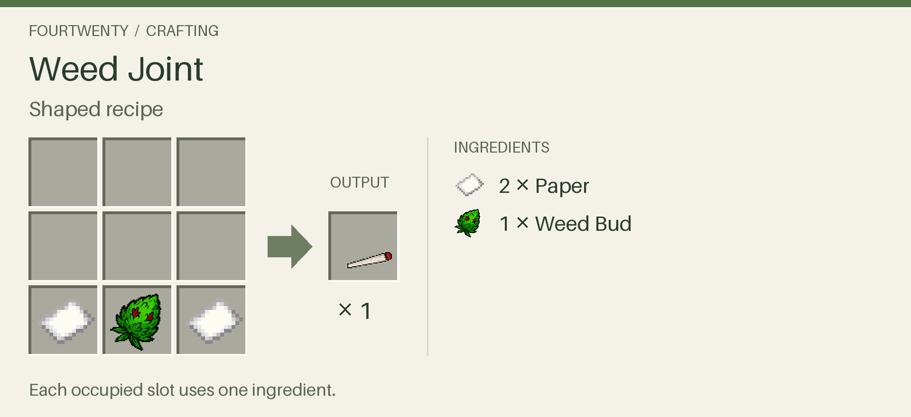
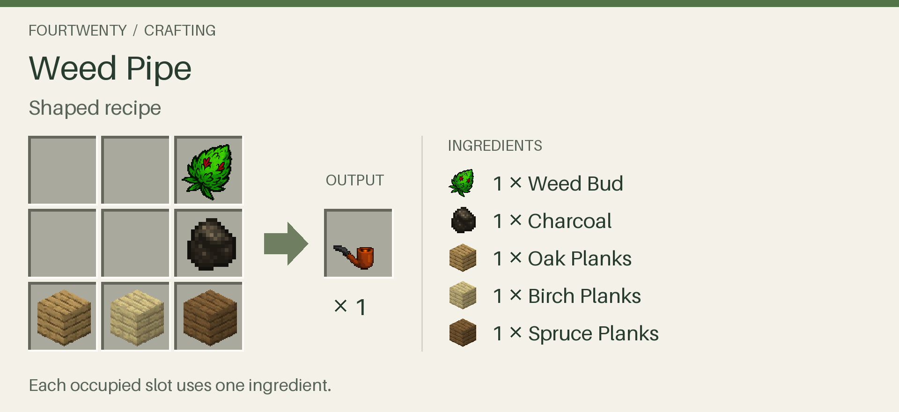
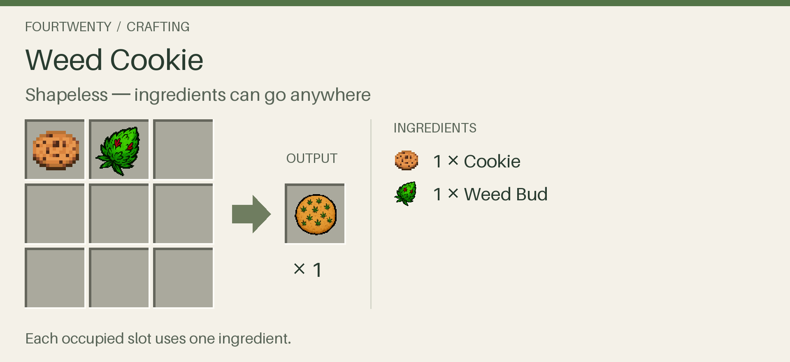
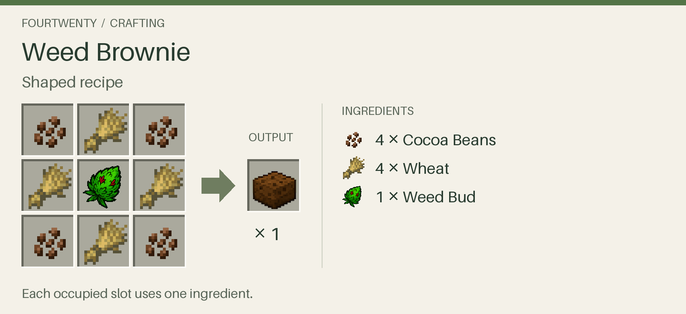
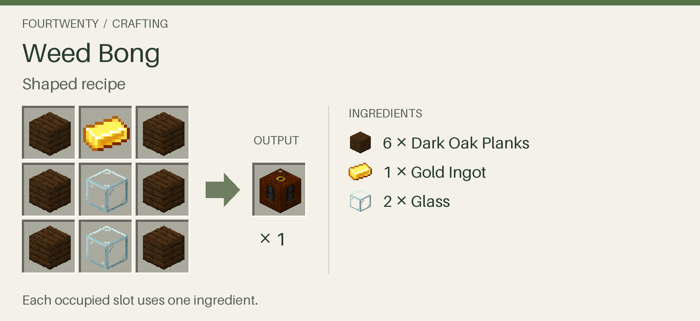
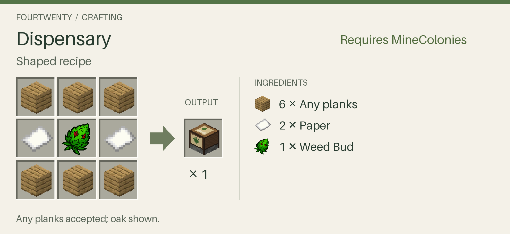

# FourTwenty 🌿

Grow wild cannabis into a farm, craft joints and edibles, build a hookah for shared effects around your base, and set out a glass bong. FourTwenty uses vanilla farming, crafting, inventory, and potion mechanics, and works without MineColonies or any other optional mod.

This compatibility candidate targets **Minecraft 1.21.1, NeoForge 21.1.218, and Java 21**. Its declared NeoForge range is `[21.1.218,21.2)`; qualification currently targets **21.1.218 specifically**. The [compatibility report](docs/COMPATIBILITY.md) distinguishes automated results from the remaining interactive and multiplayer checks. Full modpack qualification is not yet complete.

## Grow and harvest

Find wild weed in Plains, Savanna, Grove, and Meadow biomes, collect its seeds, and plant them on farmland. Cannabis grows through eight stages and responds to normal crop conditions and bone meal.

Breaking an immature crop returns one seed. A mature crop drops one seed and 1–3 buds, with a 5% chance of 1–4 extra seeds. Right-clicking a mature crop resets it to age zero and retains one seed for replanting; the remaining harvest drops normally. Right-clicking an immature crop does nothing.

MineColonies farmers recognize the crop and its seeds through their native farming support. Actually Harvest uses its configured harvesting, replanting, tool-area, and XP behavior. With both installed, FourTwenty checks colony permissions for every cannabis crop in an area harvest. Datapacks can override the loot and additive tags.

## Craft and consume

Craft joints, pipes, cookies, brownies, hookahs, and bongs with the existing recipes. Cookies take 200 server ticks to start their effects; brownies take 300. At 20 ticks per second, that is 10 and 15 seconds. Another edible cannot be consumed while a dose is pending.

Pending effects survive dimension travel, but cancel on logout, actual death, or server shutdown. Sleep and changes to the daylight clock do not advance the delay. Effects already applied follow vanilla effect merging and milk removal. MineColonies citizens exclude the cookies and brownies from food selection; normal inventory storage and transport remain available.

### Crafting recipes

Each recipe below makes **one item**. Follow the shown arrangement for shaped recipes; the cookie ingredients can go anywhere in the crafting grid.

<!-- Regenerate cards with Pillow 12.3.0: python3 tools/generate_recipe_cards.py --minecraft-jar /path/to/1.21.1.jar -->

#### Weed Joint

**Ingredients:** 2 paper + 1 weed bud → **1 Weed Joint**.



#### Weed Pipe

**Ingredients:** 1 weed bud + 1 charcoal + 1 oak plank + 1 birch plank + 1 spruce plank → **1 Weed Pipe**. Use the specific wood types shown.



#### Weed Cookie

**Ingredients:** 1 cookie + 1 weed bud → **1 Weed Cookie**. **Shapeless — ingredients can go anywhere.**



#### Weed Brownie

**Ingredients:** 4 cocoa beans + 4 wheat + 1 weed bud → **1 Weed Brownie**.



#### Hookah

**Ingredients:** 6 dark oak planks + 2 glass blocks + 1 gold ingot → **1 Hookah**.



#### Bong

**Ingredients:** 4 glass blocks + 1 water bucket → **1 Bong** (the bucket is returned).

```
 G
 G
GWG
```

`G` glass, `W` water bucket.

## Dispensary (optional MineColonies integration)

**Requires MineColonies.** With the pinned MineColonies build installed, craft the hut using **6 of any planks + 2 paper + 1 weed bud → 1 Dispensary**. Oak is shown as an example; any combination of planks works.



Use **Build Tool → Switch Pack → FourTwenty → Dispensary → dispensary1** to place the shop. The level selector previews levels 1–5; request construction, upgrades, and repairs through the standard hut controls.

Reserve **17×23 blocks** for the finished shop and lounge. Facing the north-facing entrance, the hut stays in the same place at every level: reserve eight blocks to either side, three toward the entrance, and nineteen behind it, including the hut column. Keep fourteen blocks of vertical space from the foundation. Rotate or mirror this area with your preview.

| Completed level | Footprint | Indoor seats | Joint stock target |
| --- | --- | ---: | ---: |
| 1 | 9×11 | 2 | 16 |
| 2 | 11×14 | 4 | 32 |
| 3 | 13×17 | 6 | 64 |
| 4 | 15×20 | 8 | 96 |
| 5 | 17×23 | 10 | 128 |

Hire one Budtender and stock your warehouse with weed buds and paper. Native couriers supply production: **one bud and two paper make one joint**. As the Dispensary levels up he also crafts the rest of the menu with the crafting-table recipes: **weed cookies** at level 2 (a cookie and a bud), **pipes** at level 3 (oak, birch and spruce planks, charcoal and a bud) and **weed brownies** at level 4 (four cocoa beans, four wheat and a bud), keeping each item stocked. He makes one small batch at a time for whichever item is least stocked against its target (8 joints, 4 cookies or brownies, or 2 pipes), so the shop always has some of everything. He also keeps a reserve of raw buds that he never crafts from (4 at level 1, up to 16 at level 5), for bong sessions and the hookah, and requests buds from the colony to keep that reserve plus his next batch on hand. Use the hut and linked racks for service stock; the decorative barrel is separate storage. The **Dispensary service** tab shows staff, ingredients, total joints, stock target, joints available in the shop, waiting customers, and supply problems. Total stock includes the Budtender's inventory; stock the Budtender carries out of the shop is not immediately available. Standard management and crafting tabs remain available. Clear storage space if production backs up.

Adult citizens with an assigned, completed home of any level (including guards and unemployed adults) can develop cravings, but **only after their first exposure to weed**: standing in a burning hookah's area, being within 4 blocks of a colonist or player smoking a joint or pipe, or a dose. Children do not participate. Every citizen's record logs that first exposure (N/A until it happens); existing citizens start unexposed.

First exposure rolls the citizen's **affinity** once:

- **Type:** not interested 20%, smoker 35%, edibles only 20%, both 25%.
- **Frequency:** every 4 days, every 2 days, daily, twice a day, three times a day, or four times a day. It starts somewhere from every 4 days to three times a day, usually daily.
- **Drift:** each dose, and the first hookah session each day, has a 10% chance to shift frequency one step (75% up, 25% down).
- **Tolerance break:** a citizen pushed past four times a day takes a two-day break: a small happiness penalty and no cravings. They then return to their original frequency.
- **Where to see it:** the citizen's happiness tab shows their cannabis status with type and frequency in the tooltip, or "never tried it".
- **Settings:** `affinityChangeChance`, `affinityUpChance`, `toleranceBreakTicks`, `toleranceBreakWeight` and `secondhandSmokeRadius`. The daily interval and grace (`demandIntervalTicks`, `demandGraceTicks`) are scaled by frequency.

A level-1 dispensary can serve them. Citizens use a carried joint, edible or pipe first, or visit to collect. What a visit hands out depends on the citizen's home: level 1–2 homes have one at the shop; level 3–4 homes take a supply away (a pipe holds 4 doses, or 4 cookies or brownies) and use it whenever due; level 5 homes have one at the shop and take a pipe home. They take the best item in stock: brownie, then pipe, then cookie, then joint. If there is nothing to take home, they have one at the shop and complain. Edibles count as a dose but never as food, and restaurants never serve them. Like at the restaurant, they wait anywhere inside the shop and the Budtender walks over to serve them; if he can't, they serve themselves after 20 seconds. They prefer indoor seating, smoke, and resume normal activity. Hunger, illness, sleep, combat, raids, and Kingdom's Gate rituals take priority. Missing stock causes a delayed retry.

By default, completed consumption satisfies demand and grants **one extra maximum-health heart for 24,000 simulation ticks** (20 minutes at 20 TPS). It does not immediately heal; another dose refreshes the benefit without stacking. Satisfaction gives a small happiness benefit. After satisfaction expires, a further 24,000 ticks of unmet demand produces a small penalty; newly eligible adults also receive a 24,000-tick grace period. Server configuration can change timings. Sleep and clock changes do not grant extra doses, and server downtime does not advance these timers. Collection alone grants no benefit.

**Players** can buy too: inside the shop, right-click the Budtender while holding an emerald to open the Dispensary menu, then click an item. Colony members (hut permission) are served free; other players pay emeralds, which go into the hut's storage. Default prices: joint 1, weed cookie 1, weed brownie 2, pipe 3 (`jointPrice`, `cookiePrice`, `browniePrice`, `pipePrice`). The menu grows with the Dispensary level: joints at level 1, cookies at 2, pipes at 3 and brownies at 4. Items show as sold out until they are in stock.

The [Phase 5 handoff](docs/DISPENSARY_PHASE5.md) records automated and client evidence separately from outstanding native builder, upgrade, repair, and gameplay observations.

## Use a bong

Place the bong anywhere; it faces you, bowl toward you. Right-click it with a **Weed Bud** anywhere in your inventory to take a hit: it uses one bud (none in creative) and gives the same effects as a pipe, with bubbling and smoke. Hits have a 5-second cooldown. Without a bud you are told to pack it first. With MineColonies, a hit is also secondhand smoke for colonists within 4 blocks.

## Use a hookah

Right-click the hookah to open its inventory:

| Slot | Ingredient | Capacity |
| --- | --- | ---: |
| Buds | Weed Bud | 4 |
| Water | Water Bucket | 1 |
| Fuel | Flint and Steel, Lava Bucket or Blaze Powder | 64 (stackable fuel) |

A hookah automatically consumes **one bud and one fuel when a burn starts**. The water bucket remains in its slot. How long a charge burns depends on the fuel, weakest to strongest:

| Fuel | Burn per charge | Cost |
| --- | --- | --- |
| Flint and Steel | 600 server ticks (30 s) | 1 durability |
| Lava Bucket | 900 server ticks (45 s) | the lava; an empty bucket stays in the fuel slot until removed |
| Blaze Powder | 1,200 server ticks (60 s) | 1 powder |

A burning hookah applies the existing player effects every 20 ticks within four blocks. Queued ingredients remain extractable. Removing the water extinguishes the paid charge without a refund.

With MineColonies, a burning hookah inside a colony also gives citizens within **6 blocks** a **Hookah session** happiness bonus that lasts **6,000 ticks** (5 minutes) after they were last nearby (`bongSessionWeight`, `bongSessionRadius` and `bongSessionTicks` in `fourtwenty-dispensary-server.toml`). A Budtender keeps the Dispensary's front hookah (the one nearest the hut block) ready; other hookahs are self-serve. Once the counter queue is clear it fills its water (free) and fuel (the best in the hut's storage) and returns spent lava buckets to storage; while customers are around (queuing, seated, or any other colonist inside the hut) it also adds buds, so the hookah lights. Missing fuel is requested from the colony as any item in the `fourtwenty:bong_fuel` tag, and Weed Buds are requested ahead of customers so the hookah can be lit as soon as someone arrives. Each lighting uses one bud and one fuel: flint and steel burns 30 s per lighting and loses 1 durability, a lava bucket burns 45 s and leaves an empty bucket, and blaze powder burns 60 s.

Hoppers and standard NeoForge item-handler automation can access all three slots from every face. Multi-Piston can move stocked and burning hookahs while preserving their inventory and paid charge. Vanilla piston behavior is unchanged. Breaking the hookah drops the block and its unconsumed inventory once; the active charge has already been spent.

## Install and upgrade

Install the same FourTwenty build on the server and every client. This work retains the version **0.3.2**, so compare the JAR's SHA-256 as well as its filename when replacing an older build with that version. MineColonies and the other pack mods are optional, with exact tested versions recorded in the [frozen inventory](validation/compatibility-lock.json).

Back up a world before upgrading. Registry IDs and inventory slot numbers are preserved. Existing lit hookahs receive an additive `ChargePaid` marker: their remaining bud is consumed once on the first server tick, their already-paid fuel is not charged again; saves without a per-charge burn length resume as blaze powder charges, and elapsed burn time is retained. Invalid legacy contents remain recoverable through extraction. An invalid active legacy burn stops. Unloaded hookahs pause instead of catching up offline.

For downgrade recovery, restore the backup together with its matching mod builds. Older versions do not understand the paid-charge state and should not open an upgraded save. This implementation does not modify an installed modpack or migrate any player world automatically.

## Build and test

With Java 21 and Python 3.11 or newer:

```sh
python3 tools/download_compile_dependencies.py
make build
make test-python
make help
```

The default local JAR is `build/libs/fourtwenty-0.3.2.jar`. Version tags publish a matching JAR to [GitHub Releases](https://github.com/MalevolentGods/minecraft-fourtwenty/releases). See [development and isolated runs](docs/DEVELOPMENT.md) for release instructions, the pinned sibling build, GameTests, preparation, dependency verification, launch commands, and evidence capture. Report issues with exact mod versions, JAR hashes, reproduction steps, and relevant logs.
